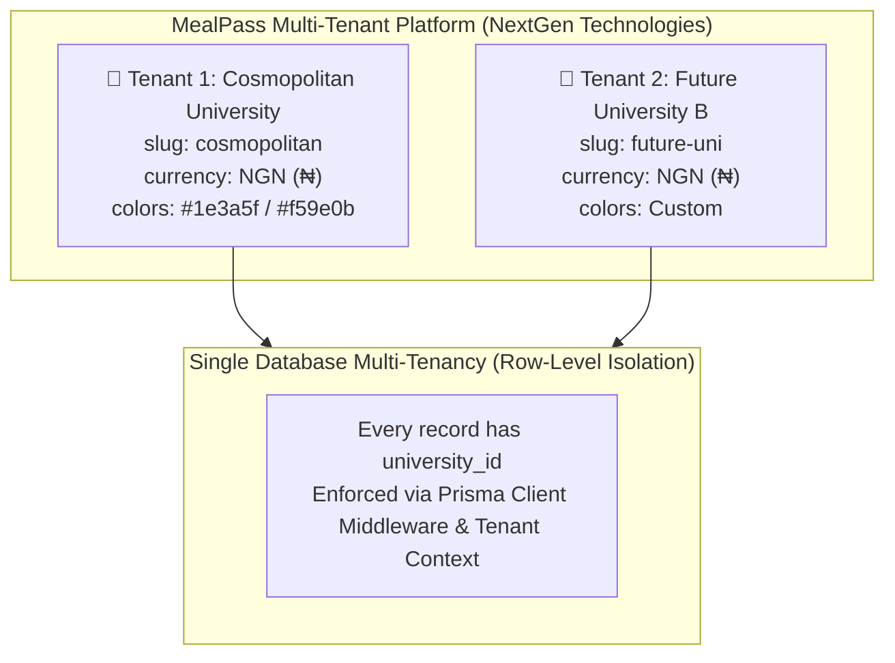
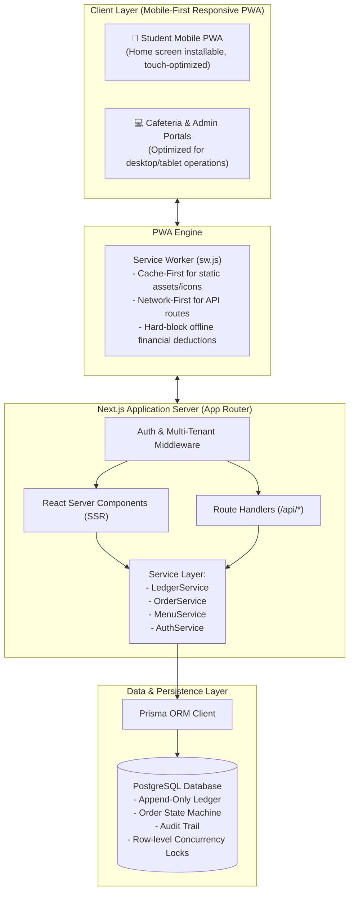

# MealPass — System Overview & Architecture

> **Version:** 1.0.0  
> **Last Updated:** 2026-10-30  
> **Author:** NextGen Technologies  
> **Client:** Cosmopolitan University  
> **Product Name:** MealPass  
> **Product Descriptor:** Digital Feeding & Cafeteria Platform  
> **Technology Attribution:** Powered by NextGen Technologies  

---

## 1. Executive Summary & Purpose

Cosmopolitan University currently manages student feeding using a manual, physical ticket booklet process:
1. Student pays school fees / feeding through university payment portal.
2. Student completes manual financial clearance.
3. Student receives physical paper receipt.
4. Student presents receipt to cafeteria head.
5. Cafeteria manually records student information in paper logbook.
6. Student receives physical ticket booklet in paper denominations.
7. Student tears physical tickets when purchasing food.

This process suffers from lost tickets, ticket counterfeiting, manual reconciliation delays, lack of real-time auditability, and cafeteria congestion during lunch rushes.

**MealPass** replaces physical tickets with a secure, real-time digital feeding ledger and mobile-first ordering Progressive Web App (PWA).

```mermaid
flowchart LR
    A["💳 Payment Verification\n(Existing University Portal)"] --> B["📥 Feeding Allocation\n(Admin/Bursary)"]
    B --> C["💰 MealPass Balance\n(Authoritative Ledger)"]
    C --> D["📱 Digital Menu & Selection\n(Student Mobile PWA)"]
    D --> E["🔒 Secure PIN Confirmation\n(Server-side Check)"]
    E --> F["⚡ Atomic Deduction\n(Order + Ledger Entry)"]
    F --> G["🧾 Digital Receipt\n(Instant Generation)"]
    G --> H["🍳 Cafeteria Queue\n(Live Order Tracking)"]
    H --> I["📦 Secure Pickup\n(QR Token / Code)"]
    I --> J["📊 Universal Sync\n(History, Ledger, Audit)"]
```

---

## 2. Core Architectural Principles

### 2.1 ENTER INFORMATION ONCE — LET THE SYSTEM PROPAGATE
A single authoritative order or financial transaction automatically updates every dependent system subsystem:
- Student's MealPass balance
- Student's transaction ledger & history
- Student's order history & digital receipt
- Cafeteria live order queue & kitchen board
- Cafeteria operational records & daily totals
- University bursary/financial ledger & administrative records
- Real-time audit logs and management reports

No staff member or administrator manually tallies tickets or reconciles numbers between different logbooks.

### 2.2 ONE TRANSACTION → MANY AUTOMATIC VIEWS
All screens (student balance card, receipt view, transaction history, cafeteria prep list, admin dashboard, finance reports) are pure projections derived from the underlying immutable database records.

### 2.3 Strict Server-Side Financial Calculations
Under no circumstances are prices, subtotals, deductions, or balances calculated or trusted from client requests. All financial logic executes strictly within isolated database transactions on the server.

### 2.4 Immutable Append-Only Ledger
The financial ledger contains zero updates and zero deletions. All corrections, adjustments, and refunds are enacted through explicit, auditable counter-entries.

### 2.5 Separation of Financial Status and Order Status
Financial transaction status (`SUCCESSFUL`, `FAILED`, `REVERSED`) and order fulfillment status (`PLACED`, `ACCEPTED`, `PREPARING`, `READY`, `RECEIVED`, `CANCELLED`) are modeled as separate entities with distinct lifecycles.

---

## 3. Technology Stack

| Layer | Technology | Specification / Role |
|---|---|---|
| **Framework** | Next.js 14+ (App Router) | Server Components, Server Actions, Route Handlers |
| **Language** | TypeScript 5+ | End-to-end strict type safety |
| **Styling** | Tailwind CSS | Mobile-first utility design, WCAG 2.1 AA accessible |
| **Database** | PostgreSQL 15+ | ACID guarantees, `SELECT ... FOR UPDATE` row locks |
| **ORM** | Prisma ORM | Type-safe schema migrations, relation client |
| **Authentication** | NextAuth.js (v5 Beta) | Role-based JWT session management |
| **Validation** | Zod | Runtime input validation on all API endpoints |
| **PWA** | Web App Manifest + Service Worker | Offline static shell, standalone mobile home screen app |
| **Security** | bcryptjs + crypto | PIN hashing, cryptographic pickup tokens |
| **Currency** | Nigerian Naira (NGN, ₦) | Bank-grade integer/decimal precision (`Decimal(12,2)`) |

---

## 4. Multi-Tenant Architecture

MealPass is designed by NextGen Technologies as an enterprise SaaS product. The initial deployment is configured for **Cosmopolitan University**, but the core architecture is completely tenant-isolated:

### Multi-Tenant Strategy
1. **Single Database with Discriminator (`university_id`):** Every tenant-scoped entity contains a mandatory `university_id` foreign key.
2. **Context Resolution:** The tenant is resolved via subdomains, URL path parameters, or user claims stored in authenticated JWT sessions.
3. **Database Indexing:** Compound indexes `[university_id, ...]` ensure zero data leakage and high query performance.

---

## 5. High-Level System Architecture

---

## 6. Offline Boundary and Security Rules

1. **No Offline Spending:** Offline financial transactions are strictly disallowed in Version 1. Any order creation requires active connectivity to verify ledger balances and lock funds.
2. **Graceful Offline Mode:** When a network drop occurs, the PWA displays clear indicators ("You are currently offline. Active connection required to place orders or refresh balance").
3. **QR Code Privacy:** Pickup QR codes contain only opaque cryptographic nonces (`pickup_qr_token`), never student matriculation numbers, wallet balances, or sensitive data.
4. **Audit Immutability:** Audit records capture user ID, tenant ID, action, IP address, user agent, before/after JSON snapshots, and timestamp.

