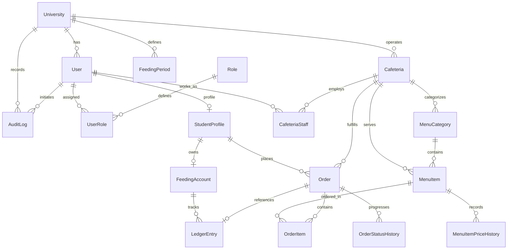

# MealPass — Data Model & Entity Relationships

> **Version:** 1.0.0  
> **Last Updated:** 2026-10-30  
> **Author:** NextGen Technologies  
> **Client:** Cosmopolitan University  
> **Database:** PostgreSQL 15+  
> **ORM:** Prisma ORM  

---

## 1. Entity Relationship Overview

---

## 2. Complete Entity Specifications

### 2.1 University (Tenant Root)
Represents a university deployment (e.g., Cosmopolitan University). Serves as tenant discriminator for multi-tenancy.

| Column | Type | Constraints | Description |
|---|---|---|---|
| `id` | UUID | PK, default uuid() | Unique identifier |
| `name` | String | NOT NULL | Institution name (e.g., "Cosmopolitan University") |
| `slug` | String | UNIQUE, NOT NULL | URL-friendly identifier (e.g., "cosmopolitan") |
| `logo_url` | String? | NULLABLE | URL/path to official university crest/logo |
| `primary_color` | String? | Default `#1e3a5f` | Primary institutional brand color |
| `secondary_color`| String? | Default `#f59e0b` | Secondary brand accent color |
| `address` | String? | NULLABLE | Physical university campus address |
| `contact_email` | String? | NULLABLE | Institutional support email |
| `contact_phone` | String? | NULLABLE | Institutional support telephone |
| `currency` | String | Default `NGN` | ISO-4217 currency code |
| `timezone` | String | Default `Africa/Lagos` | IANA timezone |
| `is_active` | Boolean | Default `true` | Tenant operational status |
| `created_at` | Timestamp | Default `now()` | Record creation timestamp |
| `updated_at` | Timestamp | Auto-update | Record modification timestamp |

---

### 2.2 User
Authenticable entity across the institution.

| Column | Type | Constraints | Description |
|---|---|---|---|
| `id` | UUID | PK, default uuid() | Unique user ID |
| `university_id` | UUID | FK -> University.id | Institutional tenant boundary |
| `email` | String | NOT NULL | University email address |
| `password_hash` | String | NOT NULL | bcrypt hash of password |
| `first_name` | String | NOT NULL | Given name |
| `last_name` | String | NOT NULL | Family/surname |
| `phone` | String? | NULLABLE | Primary mobile number |
| `avatar_url` | String? | NULLABLE | User profile photo URL |
| `is_active` | Boolean | Default `true` | Account access toggle |
| `is_email_verified`| Boolean | Default `false` | Email verification flag |
| `created_at` | Timestamp | Default `now()` | Creation timestamp |
| `updated_at` | Timestamp | Auto-update | Modification timestamp |

**Indexes & Constraints:**
- `UNIQUE(university_id, email)`
- `INDEX(university_id)`
- `INDEX(email)`

---

### 2.3 Role & UserRole (RBAC)
Configures multi-role assignments for users.

**Roles Enum:**
- `STUDENT`
- `CAFETERIA_STAFF`
- `CAFETERIA_HEAD`
- `FINANCE_ADMIN`
- `SUPER_ADMIN`

**UserRole Table:**
- `id`: UUID (PK)
- `user_id`: UUID (FK -> User.id)
- `role_id`: UUID (FK -> Role.id)
- `university_id`: UUID (FK -> University.id)
- `assigned_by`: UUID? (FK -> User.id)
- `assigned_at`: Timestamp (Default `now()`)
- `UNIQUE(user_id, role_id, university_id)`

---

### 2.4 StudentProfile
Extended profile containing university academic attributes and transaction PIN.

| Column | Type | Constraints | Description |
|---|---|---|---|
| `id` | UUID | PK, default uuid() | Profile ID |
| `user_id` | UUID | FK -> User.id, UNIQUE | 1-to-1 link with user record |
| `university_id` | UUID | FK -> University.id | Institutional tenant boundary |
| `matric_number` | String | NOT NULL | University matriculation number (e.g. `CU/2024/0142`) |
| `department` | String? | NULLABLE | Academic department (e.g. Computer Science) |
| `faculty` | String? | NULLABLE | Academic faculty |
| `level` | String? | NULLABLE | Academic level (e.g. 100L, 200L, 300L, 400L) |
| `enrollment_year`| Integer?| NULLABLE | Academic year admitted |
| `graduation_year`| Integer?| NULLABLE | Expected completion year |
| `transaction_pin_hash`| String? | NULLABLE | bcrypt hash of 4-digit transaction PIN |
| `pin_attempts` | Integer | Default `0` | Consecutive failed PIN attempts |
| `pin_locked_until` | Timestamp? | NULLABLE | Lockout timestamp if attempts exceed threshold |
| `is_feeding_active` | Boolean | Default `false` | Whether feeding clearance is granted |
| `created_at` | Timestamp | Default `now()` | Record creation timestamp |
| `updated_at` | Timestamp | Auto-update | Record modification timestamp |

**Constraints:**
- `UNIQUE(university_id, matric_number)`

---

### 2.5 FeedingAccount
Authoritative container for a student's feeding participation. **Does NOT store editable balance.** Balance is derived from the ledger.

| Column | Type | Constraints | Description |
|---|---|---|---|
| `id` | UUID | PK, default uuid() | Feeding account ID |
| `student_profile_id`| UUID | FK -> StudentProfile.id, UNIQUE | 1-to-1 link with student |
| `university_id` | UUID | FK -> University.id | Institutional tenant boundary |
| `is_active` | Boolean | Default `true` | Account active toggle |
| `created_at` | Timestamp | Default `now()` | Creation timestamp |
| `updated_at` | Timestamp | Auto-update | Modification timestamp |

---

### 2.6 LedgerEntry (Append-Only Financial Ledger)
The single source of truth for all balances and monetary actions. Zero updates, zero deletes.

| Column | Type | Constraints | Description |
|---|---|---|---|
| `id` | UUID | PK, default uuid() | Transaction record ID |
| `feeding_account_id`| UUID | FK -> FeedingAccount.id | Student feeding account |
| `university_id` | UUID | FK -> University.id | Institutional tenant boundary |
| `transaction_type`| Enum | `ALLOCATION`, `MEAL_DEDUCTION`, `REFUND`, `REVERSAL`, `ADJUSTMENT` | Transaction nature |
| `amount` | Decimal(12,2)| NOT NULL | Credit (+) or Debit (-) amount |
| `running_balance` | Decimal(12,2)| NOT NULL | Balance snapshot after this transaction |
| `reference_id` | String? | NULLABLE, Index | Correlated Order ID or parent transaction ID |
| `description` | String | NOT NULL | Human-readable transaction memo |
| `created_by` | UUID | FK -> User.id | User who initiated transaction |
| `created_at` | Timestamp | Default `now()` | Immutable transaction timestamp |
| `metadata` | JSONB? | NULLABLE | Audit context (order snapshot, IP, reason) |
| `feeding_period_id`| UUID?| NULLABLE | Semester/session feeding period |

**Indexes:**
- `INDEX(feeding_account_id, created_at)`
- `INDEX(university_id)`
- `INDEX(transaction_type)`
- `INDEX(reference_id)`

---

### 2.7 Cafeteria & CafeteriaStaff
Cafeterias operating on university grounds.

**Cafeteria Table:**
- `id`: UUID (PK)
- `university_id`: UUID (FK -> University.id)
- `name`: String (e.g. "Main Campus Cafeteria", "Annex Eatery")
- `location`: String?
- `description`: String?
- `is_active`: Boolean (Default `true`)
- `operating_hours`: JSONB? (Weekly opening/closing times)

**CafeteriaStaff Table:**
- `id`: UUID (PK)
- `user_id`: UUID (FK -> User.id)
- `cafeteria_id`: UUID (FK -> Cafeteria.id)
- `university_id`: UUID (FK -> University.id)
- `role_in_cafeteria`: Enum (`STAFF`, `HEAD`)
- `assigned_at`: Timestamp (Default `now()`)
- `assigned_by`: UUID? (FK -> User.id)
- `UNIQUE(user_id, cafeteria_id)`

---

### 2.8 MenuCategory & MenuItem
Digital cafeteria menu system. Text-first with optional photos.

**MenuCategory:**
- `id`: UUID (PK)
- `university_id`: UUID (FK -> University.id)
- `cafeteria_id`: UUID (FK -> Cafeteria.id)
- `name`: String (e.g., "Main Meals", "Proteins", "Drinks & Snacks", "Pastries")
- `display_order`: Integer (Default `0`)
- `is_active`: Boolean (Default `true`)

**MenuItem:**
- `id`: UUID (PK)
- `university_id`: UUID (FK -> University.id)
- `cafeteria_id`: UUID (FK -> Cafeteria.id)
- `category_id`: UUID (FK -> MenuCategory.id)
- `name`: String (e.g. "Jollof Rice with Fried Chicken")
- `description`: String? (Ingredients or preparation details)
- `image_url`: String? (OPTIONAL — text-first design)
- `current_price`: Decimal(12,2) (Current retail price in Naira)
- `is_available`: Boolean (Default `true` — can be toggled sold-out instantly)
- `is_active`: Boolean (Default `true` — active in menu)
- `display_order`: Integer (Default `0`)

**MenuItemPriceHistory (Auditable Price Changes):**
- `id`: UUID (PK)
- `menu_item_id`: UUID (FK -> MenuItem.id)
- `old_price`: Decimal(12,2)
- `new_price`: Decimal(12,2)
- `changed_by`: UUID (FK -> User.id)
- `changed_at`: Timestamp (Default `now()`)
- `reason`: String?

---

### 2.9 Order & OrderItem
The operational order record. Separated from the financial ledger entry.

**Order:**
| Column | Type | Constraints | Description |
|---|---|---|---|
| `id` | UUID | PK, default uuid() | Order ID |
| `order_number` | String | UNIQUE per University | Human-readable tracking number (e.g. `MP-2026-00108`) |
| `university_id` | UUID | FK -> University.id | Institutional tenant boundary |
| `student_profile_id`| UUID | FK -> StudentProfile.id | Student ordering |
| `cafeteria_id` | UUID | FK -> Cafeteria.id | Kitchen fulfilling order |
| `status` | Enum | `PLACED`, `ACCEPTED`, `PREPARING`, `READY`, `RECEIVED`, `CANCELLED` | Kitchen order lifecycle |
| `total_amount` | Decimal(12,2)| NOT NULL | Captured order total in Naira |
| `pickup_code` | String? | NULLABLE | 6-character alphanumeric pickup code (e.g. `K9X2B4`) |
| `pickup_qr_token`| String? | NULLABLE, Index | Cryptographic 64-char hex token for QR scanning |
| `notes` | String? | NULLABLE | Student dietary instructions |
| `placed_at` | Timestamp | Default `now()` | Order placement time |
| `accepted_at` | Timestamp? | NULLABLE | Time kitchen accepted order |
| `preparing_at` | Timestamp? | NULLABLE | Time cooking/packing commenced |
| `ready_at` | Timestamp? | NULLABLE | Time marked ready for pickup |
| `received_at` | Timestamp? | NULLABLE | Time student collected food |
| `received_by` | UUID? | FK -> User.id | Staff member who verified pickup |
| `cancelled_at` | Timestamp? | NULLABLE | Time cancelled |
| `cancellation_reason`| String? | NULLABLE | Reason for cancellation |

**OrderItem (Price Immutability):**
- `id`: UUID (PK)
- `order_id`: UUID (FK -> Order.id)
- `menu_item_id`: UUID (FK -> MenuItem.id)
- `item_name`: String (CAPTURED at time of order)
- `unit_price`: Decimal(12,2) (CAPTURED at time of order — unaffected by future price changes)
- `quantity`: Integer (NOT NULL, > 0)
- `subtotal`: Decimal(12,2) (`unit_price * quantity`)

**OrderStatusHistory:**
- `id`: UUID (PK)
- `order_id`: UUID (FK -> Order.id)
- `previous_status`: OrderStatus?
- `new_status`: OrderStatus
- `changed_by`: UUID (FK -> User.id)
- `reason`: String?
- `is_manual`: Boolean (Default `false` — flags manual operational overrides)
- `created_at`: Timestamp (Default `now()`)

---

### 2.10 AuditLog
Security and compliance record for administrative and sensitive operations.

- `id`: UUID (PK)
- `university_id`: UUID (FK -> University.id)
- `user_id`: UUID (FK -> User.id)
- `action`: String (e.g., `ALLOCATE_FUNDS`, `UPDATE_PRICE`, `OVERRIDE_ORDER_RECEIVED`, `LOCK_STUDENT_PIN`)
- `entity_type`: String (e.g., `FeedingAccount`, `MenuItem`, `Order`, `StudentProfile`)
- `entity_id`: String
- `old_values`: JSONB?
- `new_values`: JSONB?
- `ip_address`: String?
- `user_agent`: String?
- `created_at`: Timestamp (Default `now()`)

