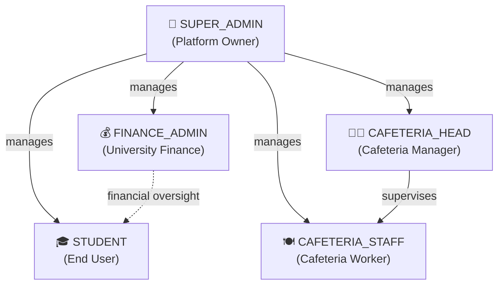
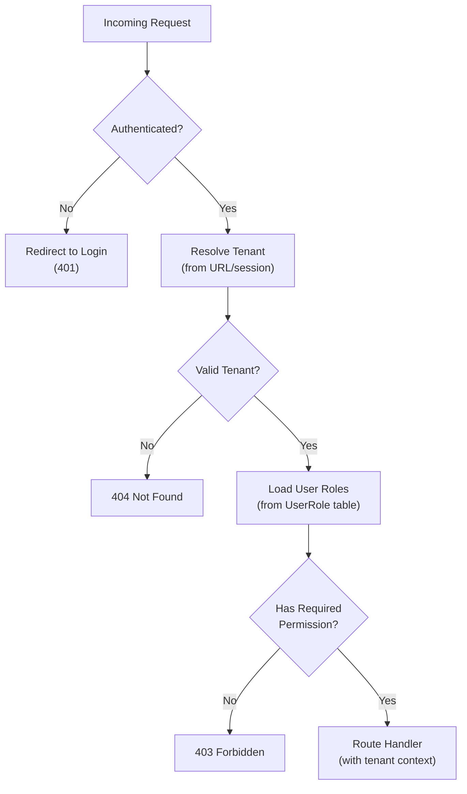
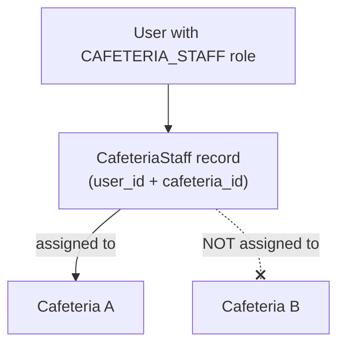

# MealPass — Roles & Permissions (RBAC)

> **Version:** 1.0.0  
> **Last Updated:** 2026-10-30  
> **Author:** NextGen Technologies  
> **Status:** Approved — Production RBAC Model

---

## 1. Role Hierarchy



### Role Definitions

| Role | Scope | Description |
|---|---|---|
| **SUPER_ADMIN** | Platform-wide | Full system access. Manages tenants, users, and all platform operations. Typically NextGen Technologies staff. |
| **FINANCE_ADMIN** | University-scoped | Manages feeding fund allocations, views financial reports, manages feeding periods. University bursary/finance department. |
| **CAFETERIA_HEAD** | University + Cafeteria-scoped | Manages a specific cafeteria: menu, staff, prices, reports. Has all CAFETERIA_STAFF permissions plus management. |
| **CAFETERIA_STAFF** | University + Cafeteria-scoped | Receives and processes orders, marks orders as received. Cannot manage menu or prices. |
| **STUDENT** | University-scoped | Views balance, browses menu, places orders, views own transaction history. |

---

## 2. Permission Inheritance Rules

1. **SUPER_ADMIN** inherits all permissions from all other roles.
2. **CAFETERIA_HEAD** inherits all permissions from CAFETERIA_STAFF within their assigned cafeteria.
3. No other inheritance exists. FINANCE_ADMIN and CAFETERIA_HEAD are independent role trees.
4. A user **may hold multiple roles** simultaneously (e.g., a user can be both FINANCE_ADMIN and CAFETERIA_HEAD).
5. Permission resolution: **union** of all permissions from all assigned roles. If any role grants a permission, it is granted.
6. Cafeteria-scoped roles (CAFETERIA_STAFF, CAFETERIA_HEAD) are **further scoped** to specific cafeterias via the `CafeteriaStaff` table.

---

## 3. Complete Permissions Matrix

### 3.1 Account & Profile Management

| Permission | Student | Caf. Staff | Caf. Head | Finance Admin | Super Admin |
|---|:---:|:---:|:---:|:---:|:---:|
| View own profile | ✅ | ✅ | ✅ | ✅ | ✅ |
| Edit own profile (name, phone, avatar) | ✅ | ✅ | ✅ | ✅ | ✅ |
| Change own password | ✅ | ✅ | ✅ | ✅ | ✅ |
| Set / change transaction PIN | ✅ | ❌ | ❌ | ❌ | ❌ |
| View own feeding balance | ✅ | ❌ | ❌ | ❌ | ✅ |
| View own transaction history | ✅ | ❌ | ❌ | ❌ | ✅ |
| View any student's balance | ❌ | ❌ | ❌ | ✅ | ✅ |
| View any student's transaction history | ❌ | ❌ | ❌ | ✅ | ✅ |

### 3.2 Menu Management

| Permission | Student | Caf. Staff | Caf. Head | Finance Admin | Super Admin |
|---|:---:|:---:|:---:|:---:|:---:|
| Browse menu (available items) | ✅ | ✅ | ✅ | ✅ | ✅ |
| View all menu items (incl. inactive) | ❌ | ✅ | ✅ | ❌ | ✅ |
| Create menu category | ❌ | ❌ | ✅ | ❌ | ✅ |
| Edit menu category | ❌ | ❌ | ✅ | ❌ | ✅ |
| Delete (deactivate) menu category | ❌ | ❌ | ✅ | ❌ | ✅ |
| Create menu item | ❌ | ❌ | ✅ | ❌ | ✅ |
| Edit menu item (name, description, image) | ❌ | ❌ | ✅ | ❌ | ✅ |
| Change menu item price | ❌ | ❌ | ✅ | ❌ | ✅ |
| Toggle item availability | ❌ | ✅ | ✅ | ❌ | ✅ |
| Delete (deactivate) menu item | ❌ | ❌ | ✅ | ❌ | ✅ |
| View price history | ❌ | ❌ | ✅ | ✅ | ✅ |

### 3.3 Order Management

| Permission | Student | Caf. Staff | Caf. Head | Finance Admin | Super Admin |
|---|:---:|:---:|:---:|:---:|:---:|
| Place an order | ✅ | ❌ | ❌ | ❌ | ❌ |
| View own orders | ✅ | ❌ | ❌ | ❌ | ✅ |
| View cafeteria order queue | ❌ | ✅ | ✅ | ❌ | ✅ |
| Accept an order (PLACED → ACCEPTED) | ❌ | ✅ | ✅ | ❌ | ✅ |
| Start preparing (ACCEPTED → PREPARING) | ❌ | ✅ | ✅ | ❌ | ✅ |
| Mark as ready (PREPARING → READY) | ❌ | ✅ | ✅ | ❌ | ✅ |
| Mark as received (READY → RECEIVED) | ❌ | ✅ | ✅ | ❌ | ✅ |
| Cancel own order (PLACED only) | ✅ | ❌ | ❌ | ❌ | ❌ |
| Cancel any order | ❌ | ❌ | ✅ | ❌ | ✅ |
| View order status history | ❌ | ❌ | ✅ | ✅ | ✅ |
| Manual "Mark as Received" override | ❌ | ❌ | ✅ | ❌ | ✅ |

### 3.4 Financial / Transaction Management

| Permission | Student | Caf. Staff | Caf. Head | Finance Admin | Super Admin |
|---|:---:|:---:|:---:|:---:|:---:|
| Allocate funds to students | ❌ | ❌ | ❌ | ✅ | ✅ |
| Bulk allocate funds | ❌ | ❌ | ❌ | ✅ | ✅ |
| Issue refund (cancelled order) | ❌ | ❌ | ✅ | ✅ | ✅ |
| Create reversal entry | ❌ | ❌ | ❌ | ✅ | ✅ |
| Create adjustment entry | ❌ | ❌ | ❌ | ✅ | ✅ |
| View all transaction ledger entries | ❌ | ❌ | ❌ | ✅ | ✅ |
| View financial summary reports | ❌ | ❌ | ❌ | ✅ | ✅ |
| View cafeteria sales report | ❌ | ❌ | ✅ | ✅ | ✅ |
| Export financial data | ❌ | ❌ | ❌ | ✅ | ✅ |

### 3.5 Feeding Period Management

| Permission | Student | Caf. Staff | Caf. Head | Finance Admin | Super Admin |
|---|:---:|:---:|:---:|:---:|:---:|
| View feeding periods | ✅ | ✅ | ✅ | ✅ | ✅ |
| Create feeding period | ❌ | ❌ | ❌ | ✅ | ✅ |
| Edit feeding period | ❌ | ❌ | ❌ | ✅ | ✅ |
| Activate / deactivate period | ❌ | ❌ | ❌ | ✅ | ✅ |

### 3.6 User Management

| Permission | Student | Caf. Staff | Caf. Head | Finance Admin | Super Admin |
|---|:---:|:---:|:---:|:---:|:---:|
| View student list | ❌ | ❌ | ❌ | ✅ | ✅ |
| Search students | ❌ | ❌ | ❌ | ✅ | ✅ |
| Register new student | ❌ | ❌ | ❌ | ✅ | ✅ |
| Activate / deactivate student | ❌ | ❌ | ❌ | ✅ | ✅ |
| Assign roles to users | ❌ | ❌ | ❌ | ❌ | ✅ |
| View staff list | ❌ | ❌ | ✅ | ❌ | ✅ |
| Manage cafeteria staff assignments | ❌ | ❌ | ✅ | ❌ | ✅ |
| Reset student transaction PIN | ❌ | ❌ | ❌ | ✅ | ✅ |
| Unlock locked student PIN | ❌ | ❌ | ❌ | ✅ | ✅ |

### 3.7 Cafeteria Management

| Permission | Student | Caf. Staff | Caf. Head | Finance Admin | Super Admin |
|---|:---:|:---:|:---:|:---:|:---:|
| View cafeteria list | ✅ | ✅ | ✅ | ✅ | ✅ |
| View cafeteria details | ✅ | ✅ | ✅ | ✅ | ✅ |
| Create cafeteria | ❌ | ❌ | ❌ | ❌ | ✅ |
| Edit cafeteria details | ❌ | ❌ | ✅ | ❌ | ✅ |
| Update operating hours | ❌ | ❌ | ✅ | ❌ | ✅ |
| Activate / deactivate cafeteria | ❌ | ❌ | ❌ | ❌ | ✅ |

### 3.8 Reporting & Analytics

| Permission | Student | Caf. Staff | Caf. Head | Finance Admin | Super Admin |
|---|:---:|:---:|:---:|:---:|:---:|
| View personal spending summary | ✅ | ❌ | ❌ | ❌ | ❌ |
| View cafeteria daily summary | ❌ | ✅ | ✅ | ❌ | ✅ |
| View cafeteria detailed reports | ❌ | ❌ | ✅ | ❌ | ✅ |
| View university-wide financial reports | ❌ | ❌ | ❌ | ✅ | ✅ |
| View allocation utilization reports | ❌ | ❌ | ❌ | ✅ | ✅ |
| View audit logs | ❌ | ❌ | ❌ | ❌ | ✅ |

### 3.9 System Administration

| Permission | Student | Caf. Staff | Caf. Head | Finance Admin | Super Admin |
|---|:---:|:---:|:---:|:---:|:---:|
| Manage university settings | ❌ | ❌ | ❌ | ❌ | ✅ |
| Create new university (tenant) | ❌ | ❌ | ❌ | ❌ | ✅ |
| View system health / stats | ❌ | ❌ | ❌ | ❌ | ✅ |
| Manage platform-wide settings | ❌ | ❌ | ❌ | ❌ | ✅ |
| View cross-tenant data | ❌ | ❌ | ❌ | ❌ | ✅ |

---

## 4. Middleware Implementation

### 4.1 Auth Middleware Pipeline



### 4.2 Implementation Approach

```typescript
// Middleware context injected into every protected route
interface AuthContext {
  user: {
    id: string;
    universityId: string;
    email: string;
    roles: RoleName[];
    cafeteriaIds: string[];  // For cafeteria-scoped roles
  };
  university: {
    id: string;
    slug: string;
    name: string;
  };
}

// Permission check helper
function requirePermission(
  context: AuthContext,
  permission: Permission,
  resourceScope?: { cafeteriaId?: string }
): void {
  // 1. SUPER_ADMIN bypasses all checks
  if (context.user.roles.includes('SUPER_ADMIN')) return;

  // 2. Check if any assigned role grants the permission
  const granted = context.user.roles.some(role =>
    ROLE_PERMISSIONS[role].includes(permission)
  );
  if (!granted) throw new ForbiddenError();

  // 3. For cafeteria-scoped permissions, verify cafeteria assignment
  if (resourceScope?.cafeteriaId) {
    const hasAccess = context.user.cafeteriaIds.includes(
      resourceScope.cafeteriaId
    );
    if (!hasAccess) throw new ForbiddenError();
  }
}
```

### 4.3 API Route Protection

```typescript
// Example: Protected API route
export async function PATCH(req: Request, { params }: { params: { id: string } }) {
  const ctx = await getAuthContext(req);

  // Permission check
  requirePermission(ctx, 'order:update_status', {
    cafeteriaId: order.cafeteriaId,
  });

  // All queries automatically scoped to tenant
  const order = await prisma.order.findFirst({
    where: {
      id: params.id,
      university_id: ctx.university.id,  // Always scoped
    },
  });

  // ... handler logic
}
```

---

## 5. Cafeteria Scoping Detail

Cafeteria-scoped roles (CAFETERIA_STAFF, CAFETERIA_HEAD) have an **additional layer** of access control:



- A CAFETERIA_STAFF user can **only** see and manage orders for cafeterias they are assigned to.
- A CAFETERIA_HEAD can manage menu, staff, and orders **only** for their assigned cafeteria(s).
- Assignment is tracked in the `CafeteriaStaff` table.
- A user may be assigned to **multiple** cafeterias (e.g., a head managing two locations).

---

## 6. Role Assignment Rules

| Action | Who Can Do It | Constraints |
|---|---|---|
| Assign STUDENT role | SUPER_ADMIN, FINANCE_ADMIN | Must have a StudentProfile and FeedingAccount |
| Assign CAFETERIA_STAFF role | SUPER_ADMIN, CAFETERIA_HEAD | Must also create CafeteriaStaff record |
| Assign CAFETERIA_HEAD role | SUPER_ADMIN | Must also create CafeteriaStaff record with `HEAD` role |
| Assign FINANCE_ADMIN role | SUPER_ADMIN | — |
| Assign SUPER_ADMIN role | SUPER_ADMIN | Restricted; requires existing SUPER_ADMIN |
| Remove any role | SUPER_ADMIN | Audit logged; does not delete historical data |

> [!IMPORTANT]
> Every role assignment is recorded in `UserRole` with `assigned_by` and `assigned_at` for full audit traceability. Role assignments are also logged in `AuditLog`.
