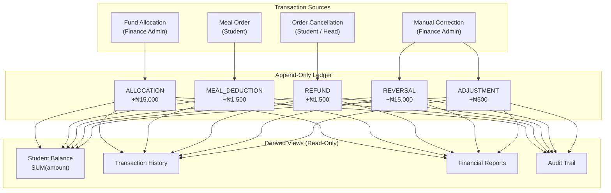
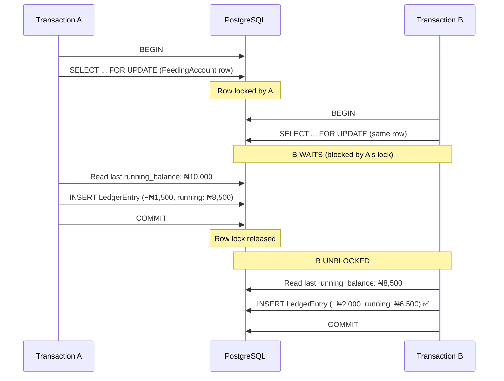
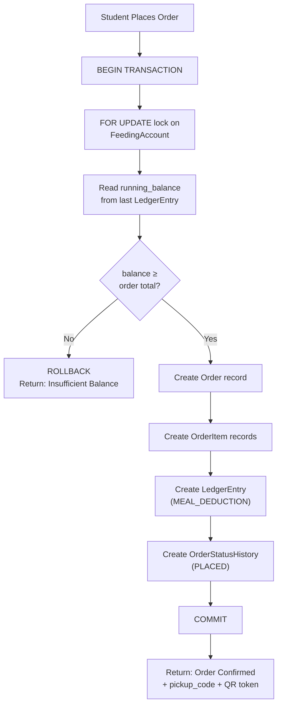

# MealPass — Transaction Ledger Architecture

> **Version:** 1.0.0  
> **Last Updated:** 2026-10-30  
> **Author:** NextGen Technologies  
> **Status:** Approved — Production Ledger Design

---

## 1. Ledger Architecture Overview

The MealPass financial system is built on an **append-only, immutable transaction ledger**. Every Naira that enters or exits a student's feeding account is recorded as a `LedgerEntry`. The ledger is the **single source of truth** for all financial data in the system.



---

## 2. Core Ledger Principles

### Principle 1: Append-Only

```
✅ INSERT INTO ledger_entry (...) VALUES (...)
❌ UPDATE ledger_entry SET amount = ... WHERE id = ...
❌ DELETE FROM ledger_entry WHERE id = ...
```

No row in the `LedgerEntry` table is ever updated or deleted. Every change is a new entry. This is enforced at:
- **Application layer:** Prisma client only exposes `create()` for this model
- **Database layer:** PostgreSQL trigger rejects `UPDATE` and `DELETE` (recommended)

### Principle 2: Balance Is Always Computed

The balance for a feeding account is never stored as a mutable field. It is always derived:

```sql
-- Authoritative balance computation
SELECT SUM(amount) AS balance
FROM ledger_entry
WHERE feeding_account_id = $1;
```

### Principle 3: Running Balance for Efficiency

Each entry stores a `running_balance` computed at creation time within the same database transaction. This allows O(1) balance lookups:

```sql
-- Fast balance lookup (uses running_balance)
SELECT running_balance
FROM ledger_entry
WHERE feeding_account_id = $1
ORDER BY created_at DESC
LIMIT 1;
```

### Principle 4: Every Entry Has an Actor

The `created_by` field records who initiated the entry. System-initiated entries (e.g., auto-deductions for orders) still reference the user who triggered the action (e.g., the student placing the order).

### Principle 5: Counter-Entries for Corrections

Mistakes are corrected by appending entries that offset the error, never by modifying existing entries.

---

## 3. Transaction Types

### 3.1 ALLOCATION

**Purpose:** Adding funds to a student's feeding account.  
**Amount:** Always **positive** (+).  
**Who:** Finance Admin, Super Admin.  
**When:** Start of semester, top-up, special allocation.

```
┌─────────────────────────────────────────────────────────────────────┐
│ ALLOCATION                                                          │
│ Amount: +₦15,000.00                                                │
│ Description: "2026/2027 First Semester feeding allocation"          │
│ Created By: Finance Admin (bursary@cosmo.edu.ng)                   │
│ Running Balance: ₦15,000.00                                        │
│ Metadata: { "feeding_period_id": "...", "batch_id": "..." }       │
└─────────────────────────────────────────────────────────────────────┘
```

### 3.2 MEAL_DEDUCTION

**Purpose:** Deducting funds when a student places an order.  
**Amount:** Always **negative** (−).  
**Who:** System (triggered by the student placing an order).  
**When:** At order placement, within the same database transaction.

```
┌─────────────────────────────────────────────────────────────────────┐
│ MEAL_DEDUCTION                                                      │
│ Amount: −₦1,500.00                                                 │
│ Description: "Order MP-2026-00042 at Main Cafeteria"               │
│ Reference ID: order_uuid (FK → Order)                              │
│ Created By: Student (STU/2026/001)                                 │
│ Running Balance: ₦13,500.00                                        │
│ Metadata: { "order_number": "MP-2026-00042", "items": 3 }         │
└─────────────────────────────────────────────────────────────────────┘
```

### 3.3 REFUND

**Purpose:** Returning funds for a cancelled order.  
**Amount:** Always **positive** (+).  
**Who:** System (triggered by order cancellation).  
**When:** When an order is cancelled (before pickup).

```
┌─────────────────────────────────────────────────────────────────────┐
│ REFUND                                                              │
│ Amount: +₦1,500.00                                                 │
│ Description: "Refund for cancelled order MP-2026-00042"            │
│ Reference ID: order_uuid (FK → Order)                              │
│ Created By: Cafeteria Head (head@cosmo.edu.ng)                     │
│ Running Balance: ₦15,000.00                                        │
│ Metadata: { "reason": "Student cancelled before preparation" }     │
└─────────────────────────────────────────────────────────────────────┘
```

### 3.4 REVERSAL

**Purpose:** Correcting an erroneous credit (e.g., duplicate allocation).  
**Amount:** Always **negative** (−).  
**Who:** Finance Admin, Super Admin.  
**When:** When a previous entry (usually ALLOCATION) was made in error.

```
┌─────────────────────────────────────────────────────────────────────┐
│ REVERSAL                                                            │
│ Amount: −₦15,000.00                                                │
│ Description: "Reverse duplicate allocation for STU/2026/001"       │
│ Created By: Finance Admin (bursary@cosmo.edu.ng)                   │
│ Running Balance: ₦0.00                                              │
│ Metadata: { "reversed_entry_id": "...", "ticket": "FIN-2026-099" }│
└─────────────────────────────────────────────────────────────────────┘
```

### 3.5 ADJUSTMENT

**Purpose:** Manual balance correction with audit justification.  
**Amount:** **Positive or negative** (depends on the correction).  
**Who:** Finance Admin, Super Admin.  
**When:** Dispute resolution, error correction, special circumstances.

```
┌─────────────────────────────────────────────────────────────────────┐
│ ADJUSTMENT                                                          │
│ Amount: +₦500.00                                                   │
│ Description: "Adjustment per support ticket FIN-2026-101"          │
│ Created By: Finance Admin (bursary@cosmo.edu.ng)                   │
│ Running Balance: ₦500.00                                            │
│ Metadata: {                                                        │
│   "ticket": "FIN-2026-101",                                       │
│   "reason": "System error caused double deduction on 2026-10-15", │
│   "approved_by": "finance_director_uuid"                           │
│ }                                                                   │
└─────────────────────────────────────────────────────────────────────┘
```

---

## 4. Balance Computation

### 4.1 The Authoritative Sum

```sql
-- This is the TRUTH. Always correct. O(n) on ledger entries for the account.
SELECT COALESCE(SUM(amount), 0) AS balance
FROM ledger_entry
WHERE feeding_account_id = $1;
```

### 4.2 The Running Balance Shortcut

```sql
-- This is the OPTIMIZATION. O(1) but only valid if all writes are serialized.
SELECT COALESCE(running_balance, 0) AS balance
FROM ledger_entry
WHERE feeding_account_id = $1
ORDER BY created_at DESC
LIMIT 1;

-- If no entries exist, balance is ₦0.00
```

### 4.3 Consistency Guarantee

The `running_balance` is computed **within the same database transaction** that creates the entry:

```typescript
async function createLedgerEntry(
  tx: PrismaTransaction,
  data: {
    feedingAccountId: string;
    universityId: string;
    transactionType: TransactionType;
    amount: Decimal;
    description: string;
    createdBy: string;
    referenceId?: string;
    metadata?: Record<string, unknown>;
  }
): Promise<LedgerEntry> {
  // 1. Lock the feeding account row to prevent concurrent writes
  await tx.$executeRaw`
    SELECT id FROM feeding_account
    WHERE id = ${data.feedingAccountId}
    FOR UPDATE
  `;

  // 2. Get the current balance from the last entry
  const lastEntry = await tx.ledgerEntry.findFirst({
    where: { feeding_account_id: data.feedingAccountId },
    orderBy: { created_at: 'desc' },
    select: { running_balance: true },
  });

  const currentBalance = lastEntry?.running_balance ?? new Decimal(0);
  const newBalance = currentBalance.plus(data.amount);

  // 3. Create the new entry with computed running balance
  return tx.ledgerEntry.create({
    data: {
      feeding_account_id: data.feedingAccountId,
      university_id: data.universityId,
      transaction_type: data.transactionType,
      amount: data.amount,
      running_balance: newBalance,
      description: data.description,
      created_by: data.createdBy,
      reference_id: data.referenceId,
      metadata: data.metadata,
    },
  });
}
```

---

## 5. Concurrent Transaction Handling

### 5.1 The Concurrency Problem

Two transactions attempting to modify the same account's balance simultaneously could produce incorrect `running_balance` values:

```
Time    Transaction A               Transaction B
────    ─────────────               ─────────────
T1      Read balance: ₦10,000
T2                                  Read balance: ₦10,000
T3      Write: −₦1,500
        (balance: ₦8,500)
T4                                  Write: −₦2,000
                                    (balance: ₦8,000)  ← WRONG! Should be ₦6,500
```

### 5.2 The Solution: Row-Level Locking



The `SELECT ... FOR UPDATE` on the `FeedingAccount` row serializes all balance mutations for a given account. Different accounts are not blocked by each other.

### 5.3 Implementation

```typescript
// All financial operations use Prisma's interactive transactions
await prisma.$transaction(async (tx) => {
  // 1. Acquire exclusive lock on the feeding account
  await tx.$executeRaw`
    SELECT id FROM feeding_account
    WHERE id = ${feedingAccountId}
    FOR UPDATE
  `;

  // 2. Read current balance (guaranteed consistent under lock)
  const currentBalance = await getCurrentBalance(tx, feedingAccountId);

  // 3. Validate (e.g., sufficient funds for deduction)
  if (currentBalance.lessThan(orderTotal)) {
    throw new InsufficientBalanceError(currentBalance, orderTotal);
  }

  // 4. Create ledger entry with correct running balance
  await createLedgerEntry(tx, { ... });

  // 5. Transaction commits → lock released
}, {
  isolationLevel: 'Serializable',  // Or ReadCommitted with FOR UPDATE
  timeout: 10000,  // 10 second timeout
});
```

---

## 6. Correction Workflow

> [!IMPORTANT]
> **Never delete. Never update. Always append.**

### 6.1 Correcting a Wrong Allocation

**Scenario:** Finance Admin accidentally allocated ₦15,000 to the wrong student.

```
Step 1: REVERSAL entry on the wrong student's account
        Amount: −₦15,000.00
        Description: "Reverse: allocation was intended for STU/2026/005"
        Metadata: { "reversed_entry_id": "original-entry-uuid" }

Step 2: ALLOCATION entry on the correct student's account
        Amount: +₦15,000.00
        Description: "2026/2027 First Semester feeding allocation"
```

### 6.2 Correcting a Double Deduction

**Scenario:** A bug caused two deductions for the same order.

```
Step 1: Identify the duplicate entry in the ledger
Step 2: ADJUSTMENT entry on the student's account
        Amount: +₦1,500.00  (offsetting the duplicate)
        Description: "Adjustment: duplicate deduction for order MP-2026-00042"
        Metadata: {
          "duplicate_entry_id": "duplicate-entry-uuid",
          "ticket": "BUG-2026-003",
          "approved_by": "finance_director_uuid"
        }
```

### 6.3 Cancelling an Order After Deduction

**Scenario:** Student or Cafeteria Head cancels an order that has already been deducted.

```
Step 1: REFUND entry on the student's account
        Amount: +₦1,500.00
        Reference ID: order-uuid (same order as the original deduction)
        Description: "Refund for cancelled order MP-2026-00042"
        Metadata: { "cancelled_by": "cafeteria_head_uuid", "reason": "..." }

Step 2: Order status updated to CANCELLED (separate concern)
```

---

## 7. Example Ledger Sequence

A complete lifecycle for student **Adewale Ogundimu** (STU/2026/001) at Cosmopolitan University:

| # | Date | Type | Amount | Running Balance | Description |
|---|---|---|---|---|---|
| 1 | 2026-09-01 | `ALLOCATION` | +₦15,000.00 | ₦15,000.00 | 2026/2027 First Semester feeding allocation |
| 2 | 2026-09-02 | `MEAL_DEDUCTION` | −₦1,200.00 | ₦13,800.00 | Order MP-2026-00001 at Main Cafeteria |
| 3 | 2026-09-02 | `MEAL_DEDUCTION` | −₦800.00 | ₦13,000.00 | Order MP-2026-00005 at Annex Cafeteria |
| 4 | 2026-09-03 | `MEAL_DEDUCTION` | −₦1,500.00 | ₦11,500.00 | Order MP-2026-00012 at Main Cafeteria |
| 5 | 2026-09-03 | `REFUND` | +₦1,500.00 | ₦13,000.00 | Refund for cancelled order MP-2026-00012 |
| 6 | 2026-09-05 | `MEAL_DEDUCTION` | −₦950.00 | ₦12,050.00 | Order MP-2026-00028 at Main Cafeteria |
| 7 | 2026-09-10 | `ALLOCATION` | +₦5,000.00 | ₦17,050.00 | Top-up allocation (exam period bonus) |
| 8 | 2026-09-15 | `MEAL_DEDUCTION` | −₦2,200.00 | ₦14,850.00 | Order MP-2026-00089 at Main Cafeteria |
| 9 | 2026-09-20 | `REVERSAL` | −₦5,000.00 | ₦9,850.00 | Reverse: duplicate top-up allocation |
| 10 | 2026-09-22 | `ADJUSTMENT` | +₦300.00 | ₦10,150.00 | Adjustment per ticket FIN-2026-044 |

**Current Balance: ₦10,150.00** = `SUM(+15000, −1200, −800, −1500, +1500, −950, +5000, −2200, −5000, +300)`

---

## 8. Balance Validation Before Orders

Every order placement includes a balance check **within the database transaction**:



> [!CAUTION]
> **The balance check and the deduction happen in the same transaction.** There is no window between "check" and "deduct" where the balance could change. The `FOR UPDATE` lock ensures serialized access to the account.

### Key Validation Rules

1. **Balance ≥ Order Total** — Enforced within the locked transaction.
2. **Account is active** — `FeedingAccount.is_active` must be `true`.
3. **Student feeding is active** — `StudentProfile.is_feeding_active` must be `true`.
4. **Transaction PIN verified** — PIN checked before entering the financial transaction (separate concern, but required).
5. **All items are available** — Menu items checked within the same transaction.
6. **Cafeteria is open** — Operating hours checked (can be pre-transaction).

---

## 9. Reporting Queries from the Ledger

### 9.1 Student Balance

```sql
SELECT running_balance AS balance
FROM ledger_entry
WHERE feeding_account_id = $1
ORDER BY created_at DESC
LIMIT 1;
```

### 9.2 Total Allocations This Period

```sql
SELECT COALESCE(SUM(amount), 0) AS total_allocated
FROM ledger_entry
WHERE university_id = $1
  AND transaction_type = 'ALLOCATION'
  AND created_at BETWEEN $2 AND $3;
```

### 9.3 Total Spending by Cafeteria

```sql
SELECT c.name AS cafeteria_name,
       COALESCE(SUM(ABS(le.amount)), 0) AS total_revenue
FROM ledger_entry le
JOIN "order" o ON le.reference_id = o.id
JOIN cafeteria c ON o.cafeteria_id = c.id
WHERE le.university_id = $1
  AND le.transaction_type = 'MEAL_DEDUCTION'
  AND le.created_at BETWEEN $2 AND $3
GROUP BY c.name
ORDER BY total_revenue DESC;
```

### 9.4 Allocation Utilization Rate

```sql
WITH totals AS (
  SELECT
    SUM(CASE WHEN transaction_type = 'ALLOCATION' THEN amount ELSE 0 END) AS total_allocated,
    SUM(CASE WHEN transaction_type = 'MEAL_DEDUCTION' THEN ABS(amount) ELSE 0 END) AS total_spent
  FROM ledger_entry
  WHERE university_id = $1
    AND created_at BETWEEN $2 AND $3
)
SELECT
  total_allocated,
  total_spent,
  ROUND((total_spent / NULLIF(total_allocated, 0)) * 100, 2) AS utilization_pct
FROM totals;
```

---

## 10. Ledger Integrity Checks

Periodic integrity checks should verify that `running_balance` values are consistent with the `SUM(amount)` computation:

```sql
-- Find accounts where running_balance has drifted from SUM(amount)
WITH computed AS (
  SELECT feeding_account_id,
         SUM(amount) AS sum_balance
  FROM ledger_entry
  GROUP BY feeding_account_id
),
latest AS (
  SELECT DISTINCT ON (feeding_account_id)
         feeding_account_id,
         running_balance
  FROM ledger_entry
  ORDER BY feeding_account_id, created_at DESC
)
SELECT c.feeding_account_id,
       c.sum_balance,
       l.running_balance,
       c.sum_balance - l.running_balance AS drift
FROM computed c
JOIN latest l ON c.feeding_account_id = l.feeding_account_id
WHERE c.sum_balance != l.running_balance;
```

> [!TIP]
> Run this check as a scheduled job (e.g., nightly). If drift is detected, it indicates a bug in the write path — investigate immediately. The `SUM(amount)` value is always authoritative.
