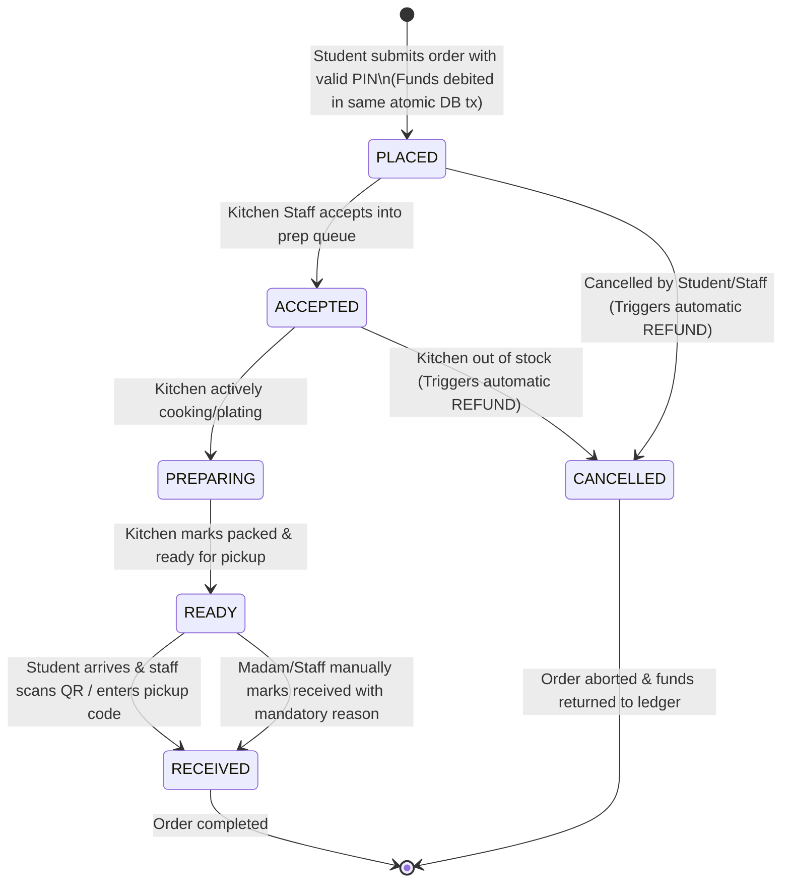
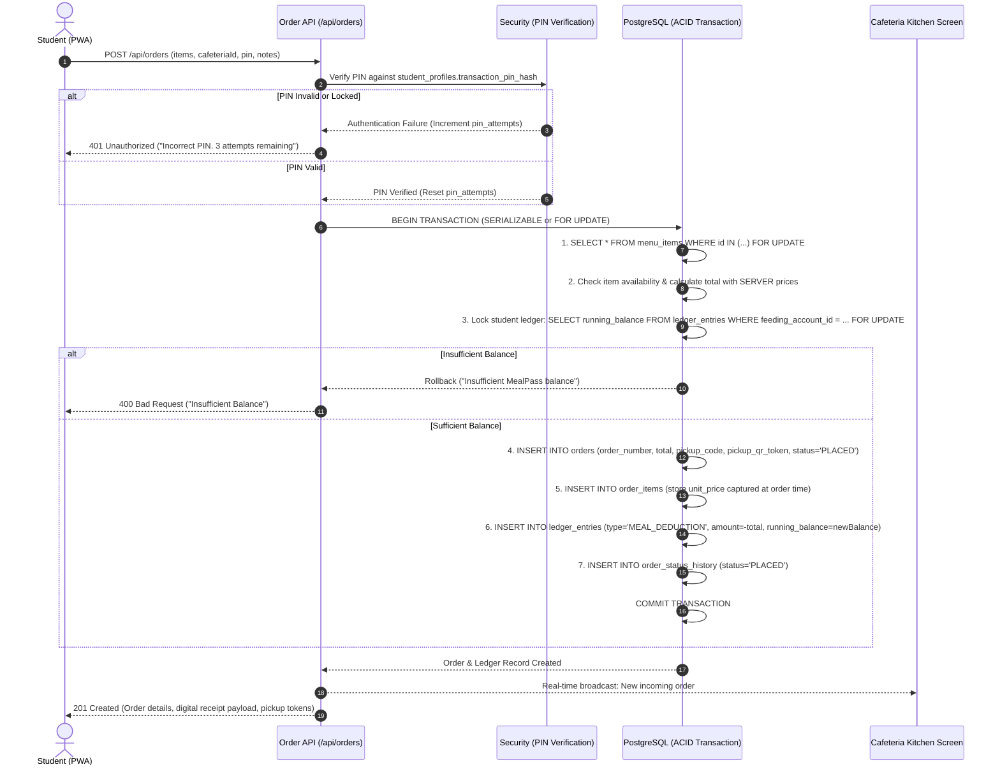

# MealPass — Order Lifecycle & Pre-Ordering Architecture

> **Version:** 1.0.0  
> **Last Updated:** 2026-10-30  
> **Author:** NextGen Technologies  
> **Client:** Cosmopolitan University  

---

## 1. Order Fulfillment State Machine

---

## 2. Pre-Ordering & Atomic Order Creation Flow

Students can pre-order from their lecture halls, hostels, or anywhere with an internet connection.

---

## 3. Order Verification & Pickup Methods

When the food is ready (`READY` status), the student visits the cafeteria pickup counter. They present proof of order using one of the following accessible options:

### 3.1 Method A: Cryptographic Pickup QR Code (Primary Mobile Flow)
- The student opens the order on their mobile PWA.
- An encrypted dynamic QR code is displayed containing the random 64-character token:
  `{"token": "e4d2...9a", "orderNumber": "MP-2026-00108"}`
- **Security Rule:** The QR payload **NEVER** contains the student's wallet balance, matriculation number, phone number, or academic record.
- Cafeteria staff uses the staff camera scanner or handheld terminal to scan the QR.
- The system validates the token and marks the order as `RECEIVED`.

### 3.2 Method B: Human-Readable 6-Character Pickup Code (Accessibility / Low Light)
- If camera scanning fails or the student's screen brightness is low, the student recites or displays the 6-character pickup code (e.g., `K9X2B4`).
- Cafeteria staff types the code on the kitchen terminal to confirm pickup.

### 3.3 Method C: Order Number Lookup (Fallback)
- In cases where the phone battery died or the device is unavailable, the student can identify themselves by order number (`MP-2026-00108`) and their student identity card.

### 3.4 Method D: Authorized Manual Override ("Madam" Override)
- For exceptional edge cases (e.g., system downtime, internet lag at the counter, or student confusion), an authorized Cafeteria Head ("Madam") or Staff member can tap **MANUALLY MARK AS RECEIVED**.
- **Audit Requirement:** The system demands a mandatory text explanation (`reason`).
- An immutable `order_status_history` record is created with `is_manual: true`.
- **Integrity Rule:** Manual confirmation changes only the fulfillment status; it **CANNOT** modify or duplicate the financial deduction.

---

## 4. Separation of Normal (Non-MealPass) Walk-in Customers

Not every cafeteria visitor is a Cosmopolitan University student on the MealPass scheme (e.g. visiting lecturers, university guests, non-boarding students, contractors).

| Flow Characteristic | MealPass Customer | Normal / Walk-In Customer |
|---|---|---|
| **Identity** | Matriculated student with MealPass profile | Anonymous or guest customer |
| **Ordering** | Pre-order on mobile PWA or counter terminal | Walk up to physical counter, speak to cashier |
| **Payment** | Deducted automatically from university feeding ledger | Cash, POS card swipe, or personal bank transfer |
| **Receipt** | Stored digitally in student account & ledger | Standard physical POS slip (if requested) |
| **Kitchen Queue** | Sent directly to kitchen prep board | Handled directly by counter serving staff |

Normal customers are served without creating unneeded MealPass accounts or entering the student ledger.

