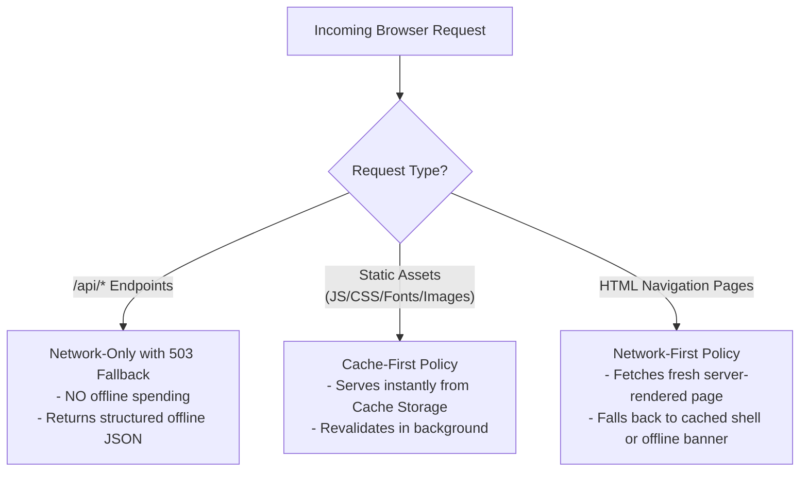

# MealPass — Progressive Web App (PWA) & Offline Boundary Architecture

> **Version:** 1.0.0  
> **Last Updated:** 2026-10-30  
> **Author:** NextGen Technologies  
> **Client:** Cosmopolitan University  

---

## 1. PWA Strategic Objectives

1. **Mobile-First Student Accessibility:** Cosmopolitan University students will access MealPass primarily through mobile web browsers (Safari on iOS, Chrome on Android).
2. **App-Like Home Screen Installability:** Enables students to add MealPass to their phone home screen as a standalone application without requiring App Store or Google Play Store distribution.
3. **Responsive Omnichannel Portals:** Cafeteria and finance staff operate comfortably on desktop screens and tablets, while retaining full responsiveness on smartphones.
4. **Strict Financial Security Perimeter:** Offline spending is strictly blocked to maintain ledger integrity.

---

## 2. Web App Manifest Specification

The manifest is served at `/manifest.json`:

```json
{
  "name": "MealPass — Digital Feeding & Cafeteria Platform",
  "short_name": "MealPass",
  "description": "Cosmopolitan University Digital Feeding & Cafeteria Management Platform, powered by NextGen Technologies",
  "start_url": "/",
  "id": "/",
  "display": "standalone",
  "orientation": "portrait-primary",
  "background_color": "#ffffff",
  "theme_color": "#1e3a5f",
  "icons": [
    {
      "src": "/icons/icon-72x72.png",
      "sizes": "72x72",
      "type": "image/png",
      "purpose": "any"
    },
    {
      "src": "/icons/icon-96x96.png",
      "sizes": "96x96",
      "type": "image/png",
      "purpose": "any"
    },
    {
      "src": "/icons/icon-128x128.png",
      "sizes": "128x128",
      "type": "image/png",
      "purpose": "any"
    },
    {
      "src": "/icons/icon-144x144.png",
      "sizes": "144x144",
      "type": "image/png",
      "purpose": "any"
    },
    {
      "src": "/icons/icon-152x152.png",
      "sizes": "152x152",
      "type": "image/png",
      "purpose": "any"
    },
    {
      "src": "/icons/icon-192x192.png",
      "sizes": "192x192",
      "type": "image/png",
      "purpose": "any maskable"
    },
    {
      "src": "/icons/icon-384x384.png",
      "sizes": "384x384",
      "type": "image/png",
      "purpose": "any"
    },
    {
      "src": "/icons/icon-512x512.png",
      "sizes": "512x512",
      "type": "image/png",
      "purpose": "any maskable"
    }
  ],
  "categories": ["food", "education", "finance"],
  "shortcuts": [
    {
      "name": "Today's Menu",
      "short_name": "Menu",
      "url": "/student/menu",
      "icons": [{ "src": "/icons/icon-96x96.png", "sizes": "96x96" }]
    },
    {
      "name": "My Orders",
      "short_name": "Orders",
      "url": "/student/orders",
      "icons": [{ "src": "/icons/icon-96x96.png", "sizes": "96x96" }]
    }
  ]
}
```

---

## 3. Service Worker Strategy & Cache Policies

The service worker (`/sw.js`) manages browser caching with strict lifecycle rules:



### 3.1 Network Boundary Enforcement Code
```javascript
// Disallow offline financial operations
if (url.pathname.startsWith('/api/')) {
  event.respondWith(
    fetch(request).catch(() => {
      return new Response(
        JSON.stringify({ 
          success: false, 
          error: 'Internet connection required. Financial transactions and balance verification cannot be performed offline.' 
        }),
        { 
          status: 503, 
          headers: { 'Content-Type': 'application/json' } 
        }
      );
    })
  );
  return;
}
```

---

## 4. Installability & PWA Prompt Experience

1. **BeforeInstallPrompt Hook:** The application listens for `beforeinstallprompt` and displays a subtle institutional banner:  
   *"Install Cosmopolitan MealPass on your phone for quick access & order alerts."*
2. **Standalone UX Polish:**  
   - Eliminates URL address bar clutter.
   - Disables rubber-band bounce on iOS (`overscroll-behavior-y: none`).
   - Configures safe-area insets (`env(safe-area-inset-bottom)`) for modern notch and gesture displays.
   - Supports active order badge counter.

